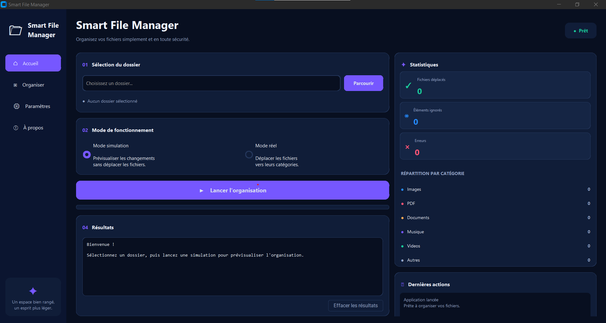

# Smart File Manager

A Python desktop application for organizing files into categorized folders through a graphical user interface.

**Project Status: In Development** 

## Main Interface

*Main interface of the Smart File Manager application.*

## About the Project

Smart File Manager is a personal project developed with Python. Its goal is to simplify file management by helping users organize files according to their types.

The application includes a graphical interface designed to make file organization easier and more convenient.

## Planned Features

- Automatic file organization by file type.
- Categorization of images, documents, PDFs, music, videos, and other files.
- Simulation mode to preview changes before moving files.
- File conflict handling to avoid overwriting existing files.
- Error handling and activity logging.
- Organization statistics and activity history.

*Features are being implemented and tested as development progresses.*

## Technologies

- **Python** — Core application logic.
- **CustomTkinter** — Graphical user interface.
- **pathlib** — File and directory path handling.
- **shutil** — File operations.
- **logging** — Application logging.
- **pytest** — Automated testing.

## Project Goals

- Build a practical desktop application using Python.
- Apply modular programming and clean code practices.
- Improve file handling and error management.
- Develop and test a user-friendly graphical interface.

## Author

**Mounira Kahlerras**

Computer Science Graduate | Aspiring Software Developer

[GitHub Profile](https://github.com/MouniraKAHLERRAS)

---

*This project is currently under development. The README will be updated as new features are completed.*
